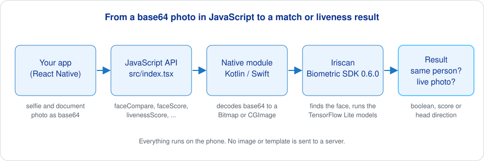

# Biometric SDK for React Native

Face comparison and liveness checks for React Native apps, running entirely on the phone. You pass two photos as base64 strings and get back whether they show the same person; you pass one photo and get back whether it is a live face or a printed photo or screen replay. Under the JavaScript API is a thin Kotlin and Swift bridge to the [Iriscan Biometric SDK](https://github.com/biometric-technologies/biometric-sdk), so no image or template leaves the device. This is the package [Inji Wallet](https://docs.iriscan.net/mosip), the reference wallet of the MOSIP national ID platform, uses for offline selfie verification.

[](https://www.npmjs.com/package/@iriscan/biometric-sdk-react-native)
[](LICENSE)

## What it does

- Compares two face photos and answers "same person or not", or gives you the raw distance score so you can set your own threshold.
- Scores a single photo for liveness, so a photo of a photo is not accepted as a person.
- Detects head direction (straight, left, right, up, down) for challenge-response checks such as "please turn your head left".
- Loads the face and liveness models from a URL or a bundled file, caches them on the device and verifies them by SHA-256 checksum if you give one.
- Works on Android (API 24 and up) and iOS (11.0 and up) with the same JavaScript calls.



## Quick start

```sh
npm install @iriscan/biometric-sdk-react-native
cd ios && pod install
```

The package contains native code, so it does not run in Expo Go. Rebuild your app after installing.

Configure the SDK once at startup, then call the functions you need. Images are base64 strings of a JPEG or PNG file.

```js
import {
  configure, faceCompare, faceScore,
  livenessScore, livenessValidate, livenessGetDirection,
} from '@iriscan/biometric-sdk-react-native';

await configure({
  withFace: {
    encoder: {
      tfModel: {
        path: 'https://github.com/biometric-technologies/tensorflow-facenet-model-test/raw/master/model.tflite',
        inputWidth: 160,
        inputHeight: 160,
        outputLength: 512,
        // optional, SHA-256 of the model file
        modelChecksum: '797b4d99794965749635352d55da38d4748c28c659ee1502338badee4614ed06',
      },
    },
    matcher: { threshold: 1.0 },
    liveness: {
      photo: {
        path: 'https://github.com/biometric-technologies/liveness-detection-model/releases/download/v0.2.0/deePix.tflite',
        inputWidth: 224,
        inputHeight: 224,
        threshold: 0.5,
      },
      direction: { threshold: 10.0 },
    },
  },
});

// face comparison
const samePerson = await faceCompare(selfieBase64, documentPhotoBase64); // true or false
const distance = await faceScore(selfieBase64, documentPhotoBase64);     // lower = more similar, -1 on error

// liveness
const score = await livenessScore(selfieBase64);          // raw model score, -1 on error
const direction = await livenessGetDirection(frameBase64); // 'STRAIGHT' | 'LEFT' | 'RIGHT' | 'UP' | 'DOWN'
```

Only the parts you configure are loaded: leave out `liveness` if you only need face comparison, or leave out `direction` if you do not need head pose.

## How it works

**The JavaScript layer** (`src/index.tsx`) is small on purpose. Each exported function calls the native module `BiometricSdkReactNative`, catches errors and returns a safe default (`false`, `-1.0` or `'STRAIGHT'`) while logging the error to the console. `faceCompare` and `faceScore` first turn each photo into a template with the native `faceExtractAndEncode` call, then compare the two templates. If the module is missing, the first call throws a message explaining that the app has to be rebuilt and that Expo Go is not supported.

**The native layer** is one class per platform: `BiometricSdkReactNativeModule.kt` for Android and `BiometricSdkReactNative.swift` for iOS. Both do the same job. `configure` reads the JavaScript object and builds the SDK configuration (`FaceNetModelConfiguration`, `FaceMatchProperties`, `LivenessModelPhotoConfiguration`, `LivenessModelPositionConfiguration`), then initializes `BiometricSdkFactory` on a background thread. The other methods decode the base64 string into a `Bitmap` on Android or a `CGImage` on iOS, hand it to the SDK and resolve the promise with the result. Templates travel back to JavaScript as base64 strings, so you can store them if you want to compare against them later without re-encoding the photo.

**The SDK** is `net.iriscan:biometric-sdk-android:0.6.0` on Android (pulled in by `android/build.gradle`) and the `BiometricSdk` 0.6.0 CocoaPod on iOS (declared in the podspec). It finds the face with ML Kit on Android and Apple Vision on iOS, aligns it, runs a FaceNet model in TensorFlow Lite to get an embedding, and compares two embeddings by Euclidean distance: `faceCompare` is true when the distance is at or below `matcher.threshold`. Liveness runs a second TensorFlow Lite model on the face crop; head direction comes from the head pose angles the face detector reports. The full API, the iris module and the server-side JVM build are described at [docs.iriscan.net/sdk](https://docs.iriscan.net/sdk).

**Models.** The configuration above points at the FaceNet model from [tensorflow-facenet-model-test](https://github.com/biometric-technologies/tensorflow-facenet-model-test) and the DeePixBiS liveness model from [liveness-detection-model](https://github.com/biometric-technologies/liveness-detection-model). The SDK downloads them on first run and caches them. When you set `modelChecksum`, the file is verified with SHA-256 and downloaded again if the cached copy does not match. You can swap in your own retrained `.tflite` model by changing the path and sizes; no code change is needed.

**Thresholds.** The match threshold depends on the model. With the FaceNet model above, a distance of 1.0 is a reasonable starting point; measure it on your own photos for the false-accept rate you need. For liveness, `livenessScore` returns the model's raw output and `livenessValidate` applies `liveness.photo.threshold` inside the SDK. Check the direction of the score for the model you ship: the example app in this repository labels the result of `livenessValidate` as "Spoof", so test with a real photo and a photo of a screen before you rely on it.

## Example app

The `example/` folder is a complete React Native 0.71 app. It loads two bundled photos, shows the match result, the distance and the liveness score for each photo, and has a "Try Liveness" button that opens the front camera with `react-native-vision-camera` and asks you to turn your head up, down, right and left, checking a frame every second with `livenessGetDirection`.

```sh
yarn bootstrap        # installs root, example and iOS pods
yarn example android  # or: yarn example ios
```

The native sources open from the example project: `example/ios/BiometricSdkReactNativeExample.xcworkspace` in Xcode, or `example/android` in Android Studio.

## Where it is used

Inji Wallet, the mobile wallet of the [MOSIP](https://docs.iriscan.net/mosip) national ID platform, calls `configure` and `faceCompare` from this package to compare a selfie with the photo inside a verifiable credential before the credential is shared. The comparison runs offline on the phone. A deployment can ship its own model through the wallet's build configuration.

## Related repositories

- [biometric-sdk](https://github.com/biometric-technologies/biometric-sdk): the Kotlin Multiplatform SDK this package wraps (Android, iOS, JVM).
- [biometric-sdk-cocoapods-release](https://github.com/biometric-technologies/biometric-sdk-cocoapods-release): the `BiometricSdk` XCFramework published to CocoaPods.
- [biometric-sdk-android-example](https://github.com/biometric-technologies/biometric-sdk-android-example) and [biometric-sdk-ios-example](https://github.com/biometric-technologies/biometric-sdk-ios-example): native example apps without React Native.
- [liveness-detection-model](https://github.com/biometric-technologies/liveness-detection-model): training code and released `.tflite` liveness models.
- [tensorflow-facenet-model-test](https://github.com/biometric-technologies/tensorflow-facenet-model-test): the FaceNet model used in the examples.
- [docs](https://github.com/biometric-technologies/docs): source of the developer documentation at docs.iriscan.net.

## Contributing

See [CONTRIBUTING.md](CONTRIBUTING.md) for the development workflow, commit message convention and how releases are published with `release-it`.

## License

MIT, copyright (c) 2023 Slava. See [LICENSE](LICENSE). The native Biometric SDK that this package depends on is licensed separately under GPL-3.0; a commercial license for closed-source products is available: https://www.iriscan.com/commercial-license.

## Contact

Questions and bug reports: [open an issue](https://github.com/biometric-technologies/biometric-sdk-react-native/issues) or write to info@iriscan.net. More about Iriscan at https://www.iriscan.com.
